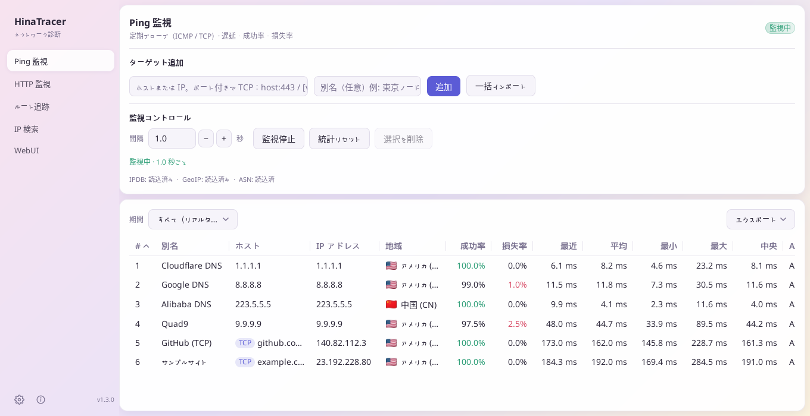
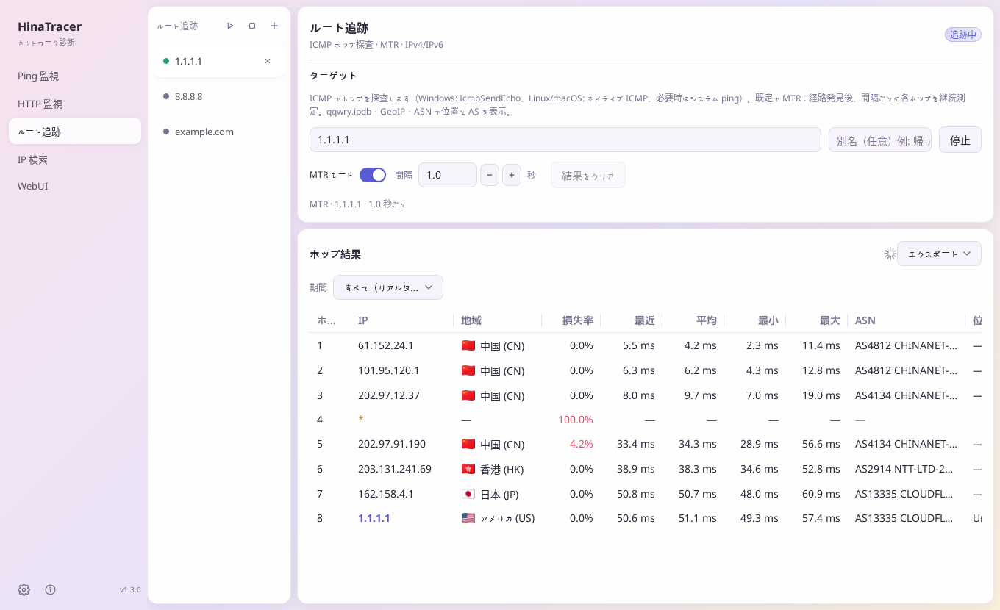
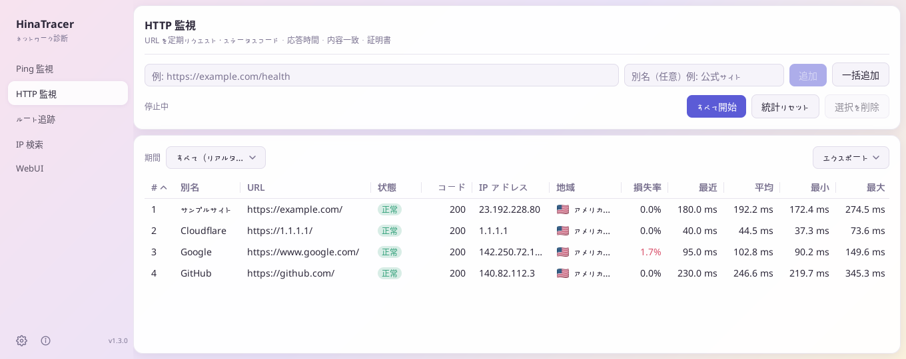
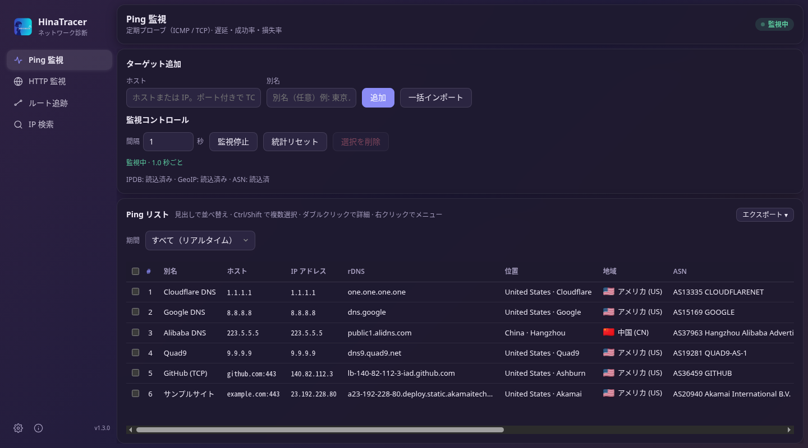

[English](README.md) | [中文(简体)](README.zh-CN.md) | [中文(繁體)](README.zh-HK.md) | 日本語

# HinaTracer


Windows・macOS・Linux 向けのネットワークツールです。Ping と HTTP の監視、ルート追跡 / MTR、IP 検索ができ、すべてのアドレスに位置・地域・ASN を表示します。デスクトップアプリのほか、ブラウザ（WebUI）、コマンドライン、AI アシスタント（MCP）からも使えます。

## スクリーンショット

<p align="center"><br /><sub>Ping 監視</sub></p>

<table>
  <tr>
    <td width="50%" align="center"><br /><sub>ルート追跡（MTR モード）</sub></td>
    <td width="50%" align="center"><br /><sub>HTTP 監視</sub></td>
  </tr>
</table>

<p align="center"><br /><sub>ブラウザーで使う WebUI（ダークテーマ）</sub></p>

## 目次

- [機能](#機能)
- [ダウンロードとインストール](#ダウンロードとインストール)
- [クイックスタート](#クイックスタート)
- [WebUI](#webui)
- [リモートデータソース](#リモートデータソース)
- [コマンドライン](#コマンドライン)
- [AI クライアント MCP](#ai-クライアント-mcp)
- [データファイル](#データファイル)
- [設定・ファイル・言語](#設定ファイル言語)
- [よくある質問](#よくある質問)
- [ライセンス](#ライセンス)

## 機能

### Ping と HTTP の監視
- 複数のターゲットを同時に監視：成功/失敗の回数と割合、最新 / 平均 / 最小 / 最大 / 中央値の遅延、IP、位置、地域、ASN。
- ICMP Ping（`example.com`、`1.1.1.1`、`2606:4700:4700::1111`）、またはポート付きの TCP Ping（`example.com:443`、`[2606:4700:4700::1111]:443`）。
- Web サイトや API の HTTP 監視：メソッド（GET、HEAD、POST、PUT、PATCH、DELETE、OPTIONS またはカスタム）、リクエスト本文と Content-Type、間隔、タイムアウト、期待するステータスコード（例 `200-299,301` や `2xx`、空欄は 200–399）、テキストまたは正規表現の一致（反転可）、カスタムヘッダー、リダイレクト追従、TLS エラーの無視。詳細ウィンドウには DNS / 接続 / TLS / 最初のバイトまでの時間と証明書の残り日数を表示します。
- 有効 / 無効、エイリアス、ドラッグで並べ替え、一括インポート、起動時の自動開始（既定はオフ）。

### ルート追跡 / MTR
- 追跡ごとに別のタブで実行し、MTR モードでは各ホップを探測し続けます。すべてのタブを一度に開始・停止できます。
- Ping ターゲットや IP 検索結果を右クリックして追跡でき、ホップはワンクリックで Ping 監視に追加できます。
- **エクスポート**：ホップ表の上の「エクスポート」ボタンまたはタブの右クリックメニューから、このタブまたはすべてのタブ（zip にまとめて）を TXT（スペースで揃えた列。等幅フォントで表示してください。全角文字は 2 桁として計算します。MS ゴシックや Sarasa Mono J などの和文等幅フォント推奨）、CSV または Markdown（見出しと短いリストの後にパイプテーブル）で保存できます。ファイル名は別名（なければターゲット）です。「TXT をコピー」は同じ内容をクリップボードにコピーします（すべてのタブでは見出し行付きで順に並べます）。「Markdown をコピー」も同様で、タブごとに `##` セクションを持つ 1 つの文書になります。5 MB を超える場合はファイルにエクスポートしてください。

### IP 検索
- IP またはドメインを 1 行に 1 つずつ検索します。ドメインはすべての IPv4 / IPv6 アドレスに解決され、それぞれの遅延を簡易測定します。

### 履歴とグラフ
- 行をダブルクリック（または Enter）すると詳細ウィンドウに遅延グラフを表示：探測ごと、分・時・日・週・月ごと（平均線、最小–最大の帯、損失の棒、十字線）。
- Ping と HTTP の履歴と表の統計をディスクに保存可能（SQLite、既定で 90 日保持）。再起動後も統計を引き継ぎます。
- 詳細ウィンドウの「エクスポート」メニューから CSV / TXT / Markdown を保存：`time,target,alias,ip,samples,avg,min,max,loss%`。「TXT をコピー」「Markdown をコピー」で同じ内容をクリップボードにコピーできます。

### 表
- 任意の列で並べ替え、列幅と列順の変更（記憶されます）、Ctrl/⌘ や Shift で複数選択（Ctrl+A / ⌘+A で全選択）、右クリックで選択中のすべての行を操作。
- **列をコピー**：選択した行の 1 列を、1 行に 1 つの値でコピーします。
- **表のエクスポート**：Ping、HTTP、IP 検索の表の上にある「エクスポート ▾」ボタンで、表示どおり（列の順序、並べ替え、期間の統計）に CSV（BOM 付き UTF-8）、TXT（スペースで整列）、Markdown で保存、または TXT / Markdown としてコピーできます。行を選択しているときは「すべての行」か「選択した行のみ」を選べます。ファイル名は `hinatracer-ping-YYYYMMDD-HHMMSS.csv` などです。ゲストもエクスポートできます。HTTP のエクスポートにはリクエストヘッダーの値と本文を含めず、URL 内のパスワードやトークンは `***` と表示します。
- **期間**：Ping・HTTP・ルート追跡の表は、リアルタイムの累計の代わりに期間の統計を表示できます：今日、昨日、今週、先週（週は月曜始まり）、今月、先月、今年、昨年、または分単位で指定した開始と終了。絞り込み中は期間が表示され、「フィルターを解除」でリアルタイムに戻ります。Ping と HTTP には履歴のディスク保存が必要です。ルート追跡のホップは今回の起動以降の測定を使います。分 / 時間 / 日の集計としてのみ残っている古い期間では、中央値は推定値です。

### デスクトップ通知
**設定 → デスクトップ通知** で設定します。既定ではすべてオフです（デスクトップアプリのみ）：
- ターゲットがダウン（設定した回数連続で失敗、既定 3 回、1–100 で変更可）したときにシステム通知を送り、復旧時にも通知できます。実行中の Ping と HTTP 監視が対象で、短時間の複数件は 1 件にまとめます。
- トレイアイコン（ウィンドウ表示、Ping / HTTP 監視の一括開始・停止、終了）と、ウィンドウを閉じたときのトレイへの最小化。

### WebUI・リモートデータソース・コマンドライン・MCP
- **WebUI**：すべての機能をブラウザで。デスクトップアプリから起動するか、ウィンドウなし（`--web`）で実行でき、パスワード・ゲストモード・API トークンに対応します。
- **リモートデータソース**：デスクトップアプリで別の HinaTracer（例：Linux サーバー）を表示・操作できます。
- スクリプトや AI アシスタント向けの **コマンドライン** と **MCP**。

### 外観
- **ガラスデザイン**：グラデーションの上に浮かぶパネル。対応する Windows 11 ではアクリル背景、それ以外では単色のグラデーションになります。Windows ではタイトルバーを HinaTracer が描画し、Windows 11 のスナップレイアウトに対応します。**設定** と **情報** はサイドバー左下のアイコンです。
- **設定 → 外観 → カラーテーマ**：6 種類（桜、ミント、オーシャン、サンセット、グラファイト、抹茶）、それぞれライトとダーク。即時反映され、保存されます。

### その他
- 更新の確認（安定版またはプレリリース版）と、新しいバージョンのダウンロード・検証・インストール。
- 中文(简体)、中文(繁體)、日本語、English と独自の言語パック。ライト・ダーク・システムに合わせるテーマ。
- デスクトップアプリは 1 つだけ起動します。もう一度開くと、実行中のウィンドウが前面に表示されます。

## ダウンロードとインストール

最新版は **[GitHub Releases](https://github.com/hinasatou/hinatracer/releases)** から入手できます。

| プラットフォーム | ファイル | 説明 |
|------------------|----------|------|
| Windows (x64) | `HinaTracer-vX.Y.Z-windows-amd64-setup.exe` | インストーラー（推奨）。現在のユーザーにインストール、管理者権限不要 |
| Windows (x64) | `HinaTracer-vX.Y.Z-windows-amd64.zip` | ポータブル版：展開して `HinaTracer.exe` を実行 |
| macOS (Apple シリコン / Intel) | `HinaTracer-vX.Y.Z-macos-arm64.dmg` / `-macos-amd64.dmg` | インストール用ディスクイメージ（推奨） |
| macOS (Apple シリコン / Intel) | `HinaTracer-vX.Y.Z-macos-arm64.zip` / `-macos-amd64.zip` | `HinaTracer.app` を含む |
| Linux (x64) | `HinaTracer-vX.Y.Z-linux-amd64.deb` | Debian / Ubuntu 用デスクトップアプリ |
| Linux (x64) | `HinaTracer-vX.Y.Z-linux-amd64.tar.gz` | ポータブルなデスクトップアプリ（アイコン付き） |
| Linux (x64) | `HinaTracer-vX.Y.Z-linux-amd64` | 単一の実行ファイル（デスクトップ、`--web`、コマンドライン） |
| Linux サーバー | `HinaTracer-vX.Y.Z-linux-amd64-server.deb` | WebUI のみ、systemd サービスとして実行 |
| すべて | `SHA256SUMS.txt` | チェックサム |

**macOS へのインストール。** `.dmg` を開き、**HinaTracer** を **Applications**（アプリケーション）フォルダーへドラッグします。

**macOS での初回起動。** アプリは Apple の署名がないため、開発元を確認できない、またはゴミ箱に入れるよう表示されることがあります。`HinaTracer.app` を右クリック → **開く**（または **システム設定 → プライバシーとセキュリティ → このまま開く**）、または次を一度実行します：

```bash
xattr -dr com.apple.quarantine /Applications/HinaTracer.app
```

**Linux の Ping 権限。** Ping が権限エラーで失敗する場合は、特権なし ICMP を許可するか、実行ファイルに raw ソケットの権限を付与します：

```bash
sudo sysctl -w net.ipv4.ping_group_range="0 2147483647"   # 再起動まで有効
sudo setcap cap_net_raw+ep /path/to/hinatracer              # またはこちらを一度
```

どちらの場合もルート追跡 / MTR はすべてのホップを表示します（一般ユーザーでも可）。

**Linux サーバーパッケージ（Debian / Ubuntu）。** WebUI だけを systemd で実行します：

```bash
sudo apt install ./HinaTracer-vX.Y.Z-linux-amd64-server.deb
sudo -u hinatracer hinatracer web passwd --config /etc/hinatracer/config.json
sudo systemctl restart hinatracer
```

`/usr/bin/hinatracer`、サービス `hinatracer.service`（ユーザー `hinatracer`、`CAP_NET_RAW` 付き）、設定 `/etc/hinatracer/config.json`、データ `/var/lib/hinatracer` がインストールされ、既定では `http://127.0.0.1:8790/` で待ち受けます。ほかのアドレスで待ち受けるにはパスワードが必要です。更新はパッケージマネージャーで行ってください（ここでは内蔵の更新は新しいバージョンを知らせるだけです）。

## クイックスタート

1. HinaTracer を起動し、**設定 → すべてダウンロード/更新** で[データファイル](#データファイル)を取得します（任意。位置・地域・ASN 用）。
2. **Ping 監視**：ホスト（`1.1.1.1`、`example.com:443`）を入力して **追加**、または **一括インポート** で 1 行に `ホスト` か `ホスト,エイリアス`（`#` で始まる行はコメント）。**監視開始** をクリック。
3. **HTTP 監視**：URL を追加、または **一括追加** で 1 行に `URL エイリアス`。右クリック → **編集** でメソッド・ステータスコード・一致条件・ヘッダーを設定。
4. **ルート追跡**：タブにホストを入力して **追跡開始**。MTR モードにチェックすると探測を続けます。
5. **IP 検索**：IP またはドメインを 1 行に 1 つ貼り付けます。
6. 行をダブルクリックすると詳細とグラフを表示します。

## WebUI

**起動方法**：デスクトップアプリの **WebUI** ページでバインド IP とポートを選び、**起動** をクリック。*HinaTracer 起動時に Web サーバーを自動起動* にチェックすると毎回起動します。ウィンドウなしでも実行できます：

```
hinatracer --web                                # 保存済みのアドレス、既定は 127.0.0.1:8790
hinatracer --web --listen 0.0.0.0:8790          # ほかの端末からアクセス可能（パスワード必須）
hinatracer --web --web-host 127.0.0.1 --web-port 9000
```

ブラウザとデスクトップウィンドウは同じ設定と実行中のタスクを共有します。ウィンドウなしモードではアドレスが表示され、`config.json` の隣の `web.log` に書き込まれます。Ctrl+C で停止します。WebUI ページには、サーバーが実際に待ち受けているアドレスが常に表示されます。

**パスワード。** `127.0.0.1` はこの PC からのみアクセスできます。ほかのアドレスにはアクセスパスワードが必要です。WebUI ページで設定するか、次を使います：

```
hinatracer web passwd                       # パスワードを入力
hinatracer web passwd --config FILE         # 別の設定ファイル
hinatracer web passwd --clear               # 削除
```

環境変数 `HINATRACER_WEB_PASSWORD` も使えます。パスワードはソルト付きハッシュとしてのみ保存され、表示されることはありません。変更するとすべてのブラウザがサインアウトします。WebUI は通常の HTTP です。信頼できないネットワークでは `127.0.0.1` のままにするか、HTTPS リバースプロキシの後ろに置いてください。

**ゲストモード。** パスワードを設定したあと **ゲストモードを許可** にチェックします。ゲストはパスワードなしでサインインでき、すべてを閲覧できますが変更はできません。ファイルパス、アクセス設定、HTTP ヘッダーの値は見えません。

**API トークン。** WebUI ページでロール **管理者**（すべて変更可）または **ゲスト**（閲覧のみ）のトークンを作成します。トークンは一度だけ表示されます。紛失した場合は失効させて作り直すしかありません。

**言語。** **設定 → 外観 → 自分の言語** はこのブラウザだけに適用されます（ゲストを含む誰でも設定可。**既定に従う** で解除）。管理者は設定ファイルに保存される **既定の言語** も設定できます。

**カラーテーマ。** WebUI も同じガラスの外観とカラーテーマを使えます。管理者は **既定のカラーテーマ** を設定します（設定ファイルに保存され、デスクトップ版でも使われます）。各ブラウザー（ゲストを含む）は **設定 → 外観 → 自分のカラーテーマ** と **自分の外観**（ライト/ダーク）で既定に従うか独自に選べ、そのブラウザーにのみ保存されます。

## リモートデータソース

**設定 → データソース → リモート WebUI** で、デスクトップウィンドウにこの PC ではなく別の HinaTracer を表示・操作させます。

- WebUI のアドレスを入力し、管理者パスワード、API トークン、またはゲスト（閲覧のみ）でサインインします。パスワードはトークンを作るために一度だけ使われ、保存されません。
- すべてのページがローカルと同じように使えます。設定ページでは **ローカル** の設定と **リモート** サーバーの設定を分けて表示します。
- アプリを終了してもローカルに戻しても、サーバー側のタスクは止まりません。
- **起動時にリモート WebUI へ自動接続**（接続後に表示、既定はオフ）。**ローカルに戻す** でこの PC に戻ります。

## コマンドライン

デスクトップアプリの WebUI または `hinatracer --web` の実行中に、ターミナルから操作できます。すべてのオプションは `hinatracer help` で確認できます。

| コマンド | 用途 |
|----------|------|
| `ping list` / `ping add <host> [--alias A]` / `ping import <file>` | Ping ターゲット |
| `ping enable` / `disable` / `delete` / `alias` / `move` `<id\|host>` | ターゲットの編集 |
| `ping start` / `ping stop` / `ping reset [--yes]` / `ping interval <s>` | 実行とリセット |
| `ping history <id\|host> [--range R] [--csv\|--txt\|--md]` | 履歴（R：probe、minute、hour、day、week、month） |
| `http list` / `http add <url> [options]` / `http edit` / `http import` | HTTP ターゲット |
| `http start` / `http stop` / `http reset [--yes]` / `http history` | 実行・リセット・履歴 |
| `trace list` / `trace new [host] [--mtr true] [--start]` / `trace show <tab>` | ルート追跡タブ |
| `trace start\|stop\|close <tab>` / `trace startall` / `trace stopall` | タブの操作 |
| `trace export <tab>\|--all [--format txt\|csv\|md] [--out FILE]` | ルート追跡結果のエクスポート（すべてのタブは zip） |
| `ping list` / `http list` / `lookup results` `--format csv\|txt\|md [--out FILE] [--sort COL [--desc]] [--cols a,b]` | Ping / HTTP / IP 検索の表をエクスポート |
| `ping list` / `http list` / `trace show <tab>` に `--range today`（`yesterday`、`thisweek`、`lastweek`、`thismonth`、`lastmonth`、`thisyear`、`lastyear`）または `--from T --to T` | 期間の統計（T：`2026-10-01 08:00` または RFC 3339） |
| `lookup <ip\|domain>...` | IP 検索 |
| `settings get` / `settings set key=value...` | 設定 |
| `data download` / `update check` | データファイルと更新 |
| `web status` / `web listen` / `web guest on\|off` / `web passwd` | WebUI のアクセス |
| `token list` / `token create <name> [--role admin\|guest]` / `token revoke <id>` | API トークン |
| `info` / `mcp tools` / `api <METHOD> <PATH> [JSON]` | その他 |

共通オプション：`--server URL`（または `HINATRACER_SERVER`。既定は保存済みの WebUI アドレス）、`--token TOKEN`（または `HINATRACER_TOKEN`。この PC でパスワード未設定なら不要）、`--json`。

プログラムのオプション：`--web`、`--listen ADDR`、`--web-host`、`--web-port`、`--config FILE`（または `HINATRACER_CONFIG`）、`--server-mode`、`--version`、`--help`。

## AI クライアント MCP

WebUI の実行中、HinaTracer は `http://HOST:PORT/mcp` の MCP サーバー（Streamable HTTP）にもなります。API トークンを付けて AI クライアントに追加します：

```json
{
  "mcpServers": {
    "hinatracer": {
      "type": "http",
      "url": "http://127.0.0.1:8790/mcp",
      "headers": { "Authorization": "Bearer htk_your_token_here" }
    }
  }
}
```

ゲストトークンは読み取りのみ、管理者トークンはターゲット・ルート追跡・設定の管理もできます。アクセスパスワード未設定なら、この PC のクライアントはトークン不要です。ツールの一覧は `hinatracer mcp tools` で確認できます。

## データファイル

位置・地域・ASN は 3 つの無料ファイルから取得します。**設定 → すべてダウンロード/更新** でまとめて取得するか、手元のファイルを指定します。ファイルがない場合、それらの列は「—」になります。

| ファイル | 用途 | 入手元 |
|----------|------|--------|
| `qqwry.ipdb` | 位置 | [nmgliangwei/qqwry.ipdb](https://github.com/nmgliangwei/qqwry.ipdb) |
| `Country.mmdb` | 地域と旗 | [Loyalsoldier/geoip](https://github.com/Loyalsoldier/geoip) |
| `ip2asn-combined.tsv.gz` | ASN、ネットワーク名、ASN の地域 | [iptoasn.com](https://iptoasn.com/) |

これらのファイルにはそれぞれのライセンスが適用されます。

## 設定・ファイル・言語

設定、ターゲット、タブは `config.json` に保存されます。`history.db`（有効時）と `crash.log`（クラッシュ後）も同じフォルダーにあります。

| OS | フォルダー |
|----|------------|
| Windows | `%APPDATA%\hinatracer\` |
| macOS | `~/Library/Application Support/hinatracer/` |
| Linux | `~/.config/hinatracer/` |
| サーバーパッケージ | `/etc/hinatracer/config.json`、データは `/var/lib/hinatracer` |

**独自の言語パック。** 上のフォルダー（またはプログラムの隣）の `lang` フォルダーに `*.json` ファイルを置きます。内蔵と同じ `code` のパックはその文字列を上書きし、足りない文字列は英語になります。[`i18n/`](i18n/) の内蔵パックをひな形にしてください：

```json
{ "name": "English", "code": "en", "strings": { "nav.ping": "Ping Monitor" } }
```

## よくある質問

**位置 / 地域 / ASN が「—」になる。** データファイルをダウンロードしてください（設定 → すべてダウンロード/更新）。

**Linux で Ping が失敗する、またはルート追跡がタイムアウトばかり。** [ダウンロードとインストール](#ダウンロードとインストール)のとおり `ping_group_range` か `setcap` を設定してください。

**macOS でアプリが壊れている、または開発元不明と表示される。** 上の *macOS での初回起動* を参照してください。

**WebUI が 0.0.0.0 で起動しない。** 先にアクセスパスワードを設定してください。

**WebUI のパスワードを忘れた。** その PC で `hinatracer web passwd` を実行します（別の設定ファイルは `--config`）。

**HinaTracer をもう一度開いても何も起きない。** すでに実行中です（トレイにある場合も）。既存のウィンドウが前面に表示されます。

**統計リセットで確認を求められる。** 履歴をディスクに保存している場合、リセットすると保存済みの統計は完全に削除されます。コマンドラインでは `--yes` を付けます。

**期間のリストがグレーになっている。** Ping と HTTP の絞り込みは保存された履歴を読みます：「設定 → 監視履歴 → 監視履歴をディスクに保存」をオンにしてください。

## ライセンス

[MIT ライセンス](LICENSE)。サードパーティーのデータファイルにはそれぞれのライセンスが適用されます。
