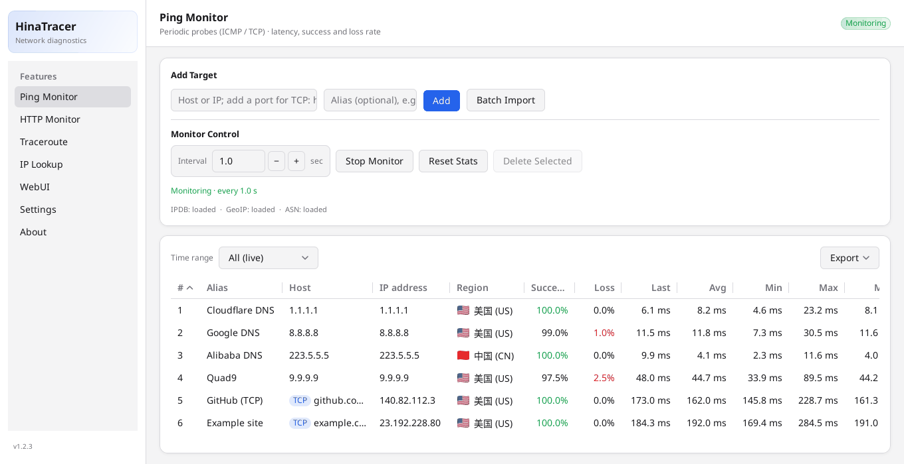
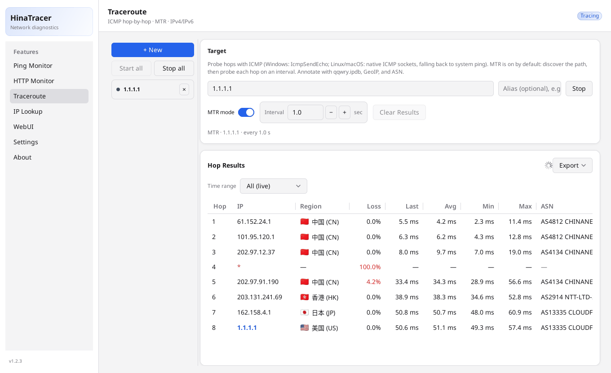
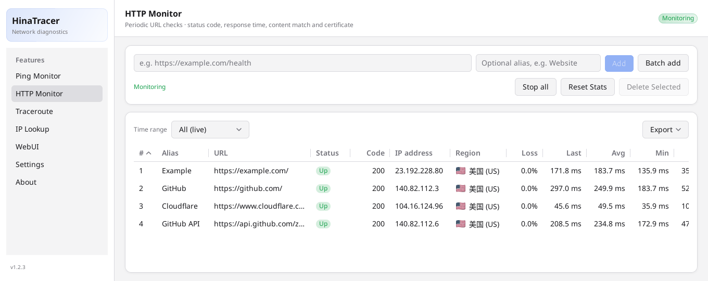
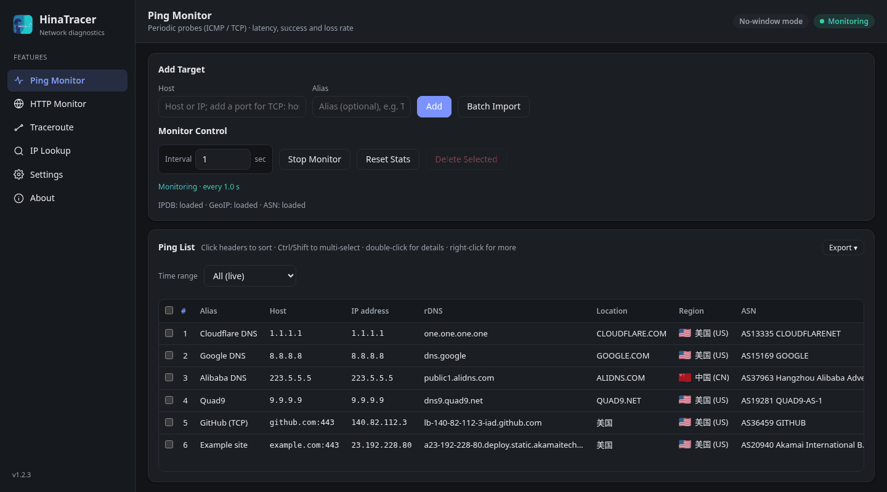

English | [中文(简体)](README.zh-CN.md) | [中文(繁體)](README.zh-HK.md) | [日本語](README.ja.md)

# HinaTracer


A network toolkit for Windows, macOS and Linux: Ping and HTTP monitoring, traceroute / MTR and IP lookup, with location, region and ASN details for every address. Use it as a desktop app, in a browser (WebUI), from the command line or from AI assistants (MCP).

## Screenshots

<p align="center"><br /><sub>Ping monitoring</sub></p>

<table>
  <tr>
    <td width="50%" align="center"><br /><sub>Traceroute (MTR mode)</sub></td>
    <td width="50%" align="center"><br /><sub>HTTP monitoring</sub></td>
  </tr>
</table>

<p align="center"><br /><sub>WebUI in a browser (dark theme)</sub></p>

## Contents

- [Features](#features)
- [Download and install](#download-and-install)
- [Quick start](#quick-start)
- [WebUI](#webui)
- [Remote data source](#remote-data-source)
- [Command line](#command-line)
- [AI clients (MCP)](#ai-clients-mcp)
- [Data files](#data-files)
- [Settings, files and languages](#settings-files-and-languages)
- [FAQ](#faq)
- [License](#license)

## Features

### Ping and HTTP monitoring
- Watch many targets at once: success and failure counts and rates, last / average / min / max / median latency, IP, location, region and ASN.
- ICMP ping (`example.com`, `1.1.1.1`, `2606:4700:4700::1111`) or TCP ping with a port (`example.com:443`, `[2606:4700:4700::1111]:443`).
- HTTP monitoring of websites and APIs: method (GET, HEAD, POST, PUT, PATCH, DELETE, OPTIONS or custom), request body and Content-Type, interval, timeout, expected status codes (e.g. `200-299,301` or `2xx`; empty means 200–399), text or regular-expression match (can be inverted), custom headers, follow redirects, ignore TLS errors. The detail window shows DNS / connect / TLS / first-byte timing and certificate days left.
- Enable / disable, alias, reorder by dragging, batch import, auto-start at launch (off by default).

### Traceroute / MTR
- Each trace runs in its own tab; MTR mode keeps probing every hop. Start or stop all tabs at once.
- Trace any Ping target or IP lookup result from the right-click menu; send a hop to Ping monitoring with one click.
- **Export**: save one tab, or every tab as a zip, as TXT (columns aligned with spaces; view it in a monospace font, CJK counted as two columns, e.g. Sarasa Mono or NSimSun for CJK), CSV or Markdown (a pipe table under a heading and a short list) from the **Export** button above the hop table or the tab's right-click menu. Files are named after the alias (or the target). **Copy TXT** puts the same text on the clipboard (all tabs: one after another, each under its own header line); **Copy Markdown** does the same as one document with a `##` section per tab; over 5 MB, export a file instead.

### IP lookup
- Look up IPs or domains, one per line. Domains resolve to all their IPv4 and IPv6 addresses, each with a quick latency check.

### History and charts
- Double-click a row (or press Enter) to open its detail window with a latency chart: per probe, per minute, hour, day, week or month (average line, min–max band, loss bars, crosshair).
- Optionally save Ping and HTTP history and table statistics to disk (SQLite, kept 90 days by default), so the totals continue after a restart.
- From the detail window's **Export** menu: CSV, TXT or Markdown files: `time,target,alias,ip,samples,avg,min,max,loss%`. **Copy TXT** / **Copy Markdown** put the same text on the clipboard.

### Tables
- Sort by any column, resize and reorder columns (remembered), multi-select with Ctrl/⌘ or Shift (Ctrl+A / ⌘+A selects all) and act on all selected rows from the right-click menu.
- **Copy column**: copy one column of all selected rows, one value per line.
- **Export table**: the **Export ▾** button above the Ping, HTTP and IP lookup tables saves the table as shown (column order, sort order, time range statistics) as CSV (UTF-8 with BOM), TXT (aligned with spaces) or Markdown, or copies it as TXT / Markdown. With rows selected, choose **All rows** or **Selected rows only**. Files are named `hinatracer-ping-YYYYMMDD-HHMMSS.csv` and so on. Guests may export too; HTTP exports never include request header values or the body, and passwords or tokens in URLs show as `***`.
- **Time range**: the Ping, HTTP and traceroute tables can show the statistics of a period instead of the live totals: today, yesterday, this week, last week (weeks start on Monday), this month, last month, this year, last year, or your own start and end to the minute. A label shows the range while it is active; **Clear filter** returns to live. Ping and HTTP need history saved to disk; traceroute hops use the probes since the program started. For older periods that are only kept as minute / hour / day summaries, the median is an estimate.

### Desktop alerts
All off by default, under **Settings → Desktop alerts** (desktop app only):
- System notification when a target goes down (a set number of failures in a row, default 3, adjustable 1–100) and optionally when it recovers. Covers running Ping and HTTP monitoring; bursts are combined into one notification.
- Tray icon (show window, start/stop all Ping or HTTP monitoring, quit) and optional minimize to tray when closing the window.

### WebUI, remote data source, CLI and MCP
- **WebUI**: every feature in a browser, from the desktop app or with no window (`--web`), with password, guest mode and API tokens.
- **Remote data source**: the desktop app can show and control another HinaTracer, for example a Linux server.
- **Command line** and **MCP** for scripts and AI assistants.

### Other
- Update checker (stable or pre-release channel) that downloads, verifies and installs new versions.
- 中文(简体), 中文(繁體), 日本語 and English, plus your own language packs; light, dark or system theme.
- Only one desktop window runs at a time: opening HinaTracer again brings the running window to the front.

## Download and install

Get the latest version from **[GitHub Releases](https://github.com/hinasatou/hinatracer/releases)**.

| Platform | File | Notes |
|----------|------|-------|
| Windows (x64) | `HinaTracer-vX.Y.Z-windows-amd64-setup.exe` | Installer (recommended), per user, no admin rights needed |
| Windows (x64) | `HinaTracer-vX.Y.Z-windows-amd64.zip` | Portable: unzip and run `HinaTracer.exe` |
| macOS (Apple silicon / Intel) | `HinaTracer-vX.Y.Z-macos-arm64.dmg` / `-macos-amd64.dmg` | Installer disk image (recommended) |
| macOS (Apple silicon / Intel) | `HinaTracer-vX.Y.Z-macos-arm64.zip` / `-macos-amd64.zip` | Contains `HinaTracer.app` |
| Linux (x64) | `HinaTracer-vX.Y.Z-linux-amd64.deb` | Desktop app for Debian / Ubuntu |
| Linux (x64) | `HinaTracer-vX.Y.Z-linux-amd64.tar.gz` | Portable desktop app with icon |
| Linux (x64) | `HinaTracer-vX.Y.Z-linux-amd64` | Single binary (desktop, `--web` or command line) |
| Linux server | `HinaTracer-vX.Y.Z-linux-amd64-server.deb` | WebUI only, as a systemd service |
| All | `SHA256SUMS.txt` | Checksums |

**macOS install.** Open the `.dmg` and drag **HinaTracer** onto **Applications**.

**macOS first launch.** The app is not signed by Apple, so macOS may say it cannot be verified or offer to move it to the Trash. Right-click `HinaTracer.app` → **Open** (or **System Settings → Privacy & Security → Open Anyway**), or run once:

```bash
xattr -dr com.apple.quarantine /Applications/HinaTracer.app
```

**Linux ping permission.** If pings fail with a permission error, allow unprivileged ICMP, or give the binary the raw-socket capability:

```bash
sudo sysctl -w net.ipv4.ping_group_range="0 2147483647"   # until reboot
sudo setcap cap_net_raw+ep /path/to/hinatracer              # or this, once
```

Traceroute / MTR shows every hop either way, also as a normal user.

**Linux server package (Debian / Ubuntu).** Runs only the WebUI, under systemd:

```bash
sudo apt install ./HinaTracer-vX.Y.Z-linux-amd64-server.deb
sudo -u hinatracer hinatracer web passwd --config /etc/hinatracer/config.json
sudo systemctl restart hinatracer
```

It installs `/usr/bin/hinatracer`, the service `hinatracer.service` (user `hinatracer`, with `CAP_NET_RAW`), the config `/etc/hinatracer/config.json` and data in `/var/lib/hinatracer`, and listens on `http://127.0.0.1:8790/` by default. A password is required before listening on another address. Upgrade with the package manager (the built-in updater only reports new versions here).

## Quick start

1. Start HinaTracer and open **Settings → Download / update all** to fetch the [data files](#data-files) (optional, for location, region and ASN).
2. **Ping Monitor**: enter a host (`1.1.1.1`, `example.com:443`) and click **Add**, or use **Batch Import** with one `host` or `host,alias` per line (`#` starts a comment). Click **Start Monitor**.
3. **HTTP Monitor**: add a URL, or **Batch add** with one `URL alias` per line. Right-click → **Edit** for method, status codes, match and headers.
4. **Traceroute**: enter a host in a tab and click **Start Trace**; tick MTR mode to keep probing.
5. **IP Lookup**: paste IPs or domains, one per line.
6. Double-click any row for its details and chart.

## WebUI

**Start it** on the **WebUI** page of the desktop app (choose bind IP and port, click **Start**; tick *Start the web server when HinaTracer opens* to run it every time), or without a window:

```
hinatracer --web                                # saved address, default 127.0.0.1:8790
hinatracer --web --listen 0.0.0.0:8790          # reachable from other devices (password required)
hinatracer --web --web-host 127.0.0.1 --web-port 9000
```

The browser and the desktop window share the same settings and running tasks. In no-window mode the address is printed and written to `web.log` next to `config.json`; Ctrl+C stops it. The WebUI page always shows the address the server is actually listening on.

**Password.** `127.0.0.1` is reachable only from this computer. Any other address needs an access password, set on the WebUI page or with:

```
hinatracer web passwd                       # asks for the password
hinatracer web passwd --config FILE         # for another config file
hinatracer web passwd --clear               # remove it
```

or the `HINATRACER_WEB_PASSWORD` environment variable. The password is stored only as a salted hash and is never shown. Changing it signs out every browser. The WebUI uses plain HTTP: on untrusted networks keep it on `127.0.0.1` or put it behind an HTTPS reverse proxy.

**Guest mode.** With a password set, tick **Allow guest mode**. Guests sign in without a password and can view everything but change nothing; they don't see file paths, access settings or HTTP header values.

**API tokens.** Create tokens on the WebUI page with role **Admin** (full access) or **Guest** (read only). A token is shown only once; lost tokens can only be revoked and replaced.

**Language.** **Settings → Appearance → My language** applies to this browser only (anyone, including guests; **Follow default** clears it). Admins also set **Default language**, which is saved in the config.

## Remote data source

**Settings → Data source → Remote WebUI** makes the desktop window show and control another HinaTracer instead of this computer.

- Enter the WebUI address and sign in with the admin password, an API token, or as a guest (read only). The password is used once to create a token and is not saved.
- Every page works as locally. Settings shows **Local** settings (this computer) and **Remote** server settings separately.
- Quitting the app or switching back to local never stops anything on the server.
- **Connect to the remote WebUI automatically at startup** (shown after connecting, off by default). Switch back with **Switch back to local**.

## Command line

With the desktop app's WebUI or `hinatracer --web` running, control it from a terminal. Run `hinatracer help` for every option.

| Command | Purpose |
|---------|---------|
| `ping list` / `ping add <host> [--alias A]` / `ping import <file>` | Ping targets |
| `ping enable` / `disable` / `delete` / `alias` / `move` `<id\|host>` | Edit targets |
| `ping start` / `ping stop` / `ping reset [--yes]` / `ping interval <s>` | Run and reset |
| `ping history <id\|host> [--range R] [--csv\|--txt\|--md]` | History (R: probe, minute, hour, day, week, month) |
| `http list` / `http add <url> [options]` / `http edit` / `http import` | HTTP targets |
| `http start` / `http stop` / `http reset [--yes]` / `http history` | Run, reset, history |
| `trace list` / `trace new [host] [--mtr true] [--start]` / `trace show <tab>` | Traceroute tabs |
| `trace start\|stop\|close <tab>` / `trace startall` / `trace stopall` | Control tabs |
| `trace export <tab>\|--all [--format txt\|csv\|md] [--out FILE]` | Export trace results (all tabs: a zip) |
| `ping list` / `http list` / `lookup results` `--format csv\|txt\|md [--out FILE] [--sort COL [--desc]] [--cols a,b]` | Export the Ping / HTTP / IP lookup table |
| `ping list` / `http list` / `trace show <tab>` with `--range today` (`yesterday`, `thisweek`, `lastweek`, `thismonth`, `lastmonth`, `thisyear`, `lastyear`) or `--from T --to T` | Statistics of a period (T: `2026-10-01 08:00` or RFC 3339) |
| `lookup <ip\|domain>...` | IP lookup |
| `settings get` / `settings set key=value...` | Settings |
| `data download` / `update check` | Data files and updates |
| `web status` / `web listen` / `web guest on\|off` / `web passwd` | WebUI access |
| `token list` / `token create <name> [--role admin\|guest]` / `token revoke <id>` | API tokens |
| `info` / `mcp tools` / `api <METHOD> <PATH> [JSON]` | Other |

Common options: `--server URL` (or `HINATRACER_SERVER`; default is the saved WebUI address), `--token TOKEN` (or `HINATRACER_TOKEN`; not needed on this computer without a password) and `--json`.

Program options: `--web`, `--listen ADDR`, `--web-host`, `--web-port`, `--config FILE` (or `HINATRACER_CONFIG`), `--server-mode`, `--version`, `--help`.

## AI clients (MCP)

While the WebUI runs, HinaTracer is an MCP server (Streamable HTTP) at `http://HOST:PORT/mcp`. Add it to your AI client with an API token:

```json
{
  "mcpServers": {
    "hinatracer": {
      "type": "http",
      "url": "http://127.0.0.1:8790/mcp",
      "headers": { "Authorization": "Bearer htk_your_token_here" }
    }
  }
}
```

A guest token can only read; an admin token can also manage targets, traceroutes and settings. Without an access password, clients on this computer need no token. `hinatracer mcp tools` lists the tools.

## Data files

Location, region and ASN come from three free files. **Settings → Download / update all** fetches them, or point to files you already have. Without them those columns show “—”.

| File | Used for | Source |
|------|----------|--------|
| `qqwry.ipdb` | Location | [nmgliangwei/qqwry.ipdb](https://github.com/nmgliangwei/qqwry.ipdb) |
| `Country.mmdb` | Region and flag | [Loyalsoldier/geoip](https://github.com/Loyalsoldier/geoip) |
| `ip2asn-combined.tsv.gz` | ASN, network name, ASN region | [iptoasn.com](https://iptoasn.com/) |

These files are subject to their own licenses.

## Settings, files and languages

Settings, targets and tabs are stored in `config.json`; `history.db` (if enabled) and `crash.log` (after a crash) are in the same folder.

| OS | Folder |
|----|--------|
| Windows | `%APPDATA%\hinatracer\` |
| macOS | `~/Library/Application Support/hinatracer/` |
| Linux | `~/.config/hinatracer/` |
| Server package | `/etc/hinatracer/config.json`, data in `/var/lib/hinatracer` |

**Custom language packs.** Put a `*.json` file into a `lang` folder in the folder above (or next to the program). A pack with the same `code` as a built-in one overrides its strings; missing strings fall back to English. Use [`i18n/`](i18n/) as a template:

```json
{ "name": "English", "code": "en", "strings": { "nav.ping": "Ping Monitor" } }
```

## FAQ

**Location / region / ASN shows “—”.** Download the data files (Settings → Download / update all).

**Linux: ping fails or traceroute shows only timeouts.** Set `ping_group_range` or `setcap` as in [Download and install](#download-and-install).

**macOS says the app is damaged or from an unidentified developer.** See *macOS first launch* above.

**The WebUI won't start on 0.0.0.0.** Set an access password first.

**I forgot the WebUI password.** Run `hinatracer web passwd` on that computer (`--config` for another file).

**Nothing happens when I open HinaTracer a second time.** It is already running (perhaps in the tray); the existing window is brought to the front.

**Reset Stats asks for confirmation.** When history is saved to disk, resetting deletes the saved totals for good. On the command line add `--yes`.

**The time range list is greyed out.** Ping and HTTP filters read the saved history: turn on **Settings → Monitoring history → Save monitoring history to disk**.

## License

[MIT License](LICENSE). Third-party data files are subject to their own licenses.
