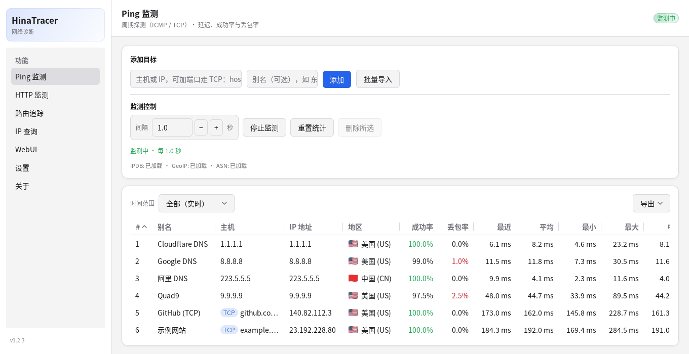
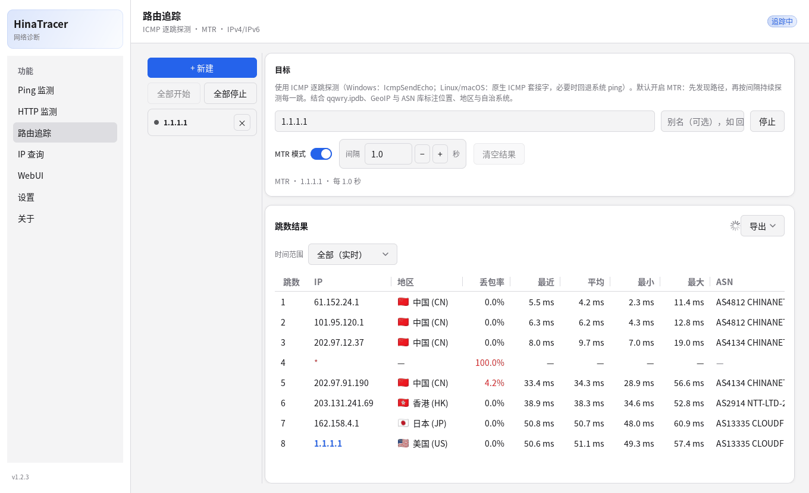
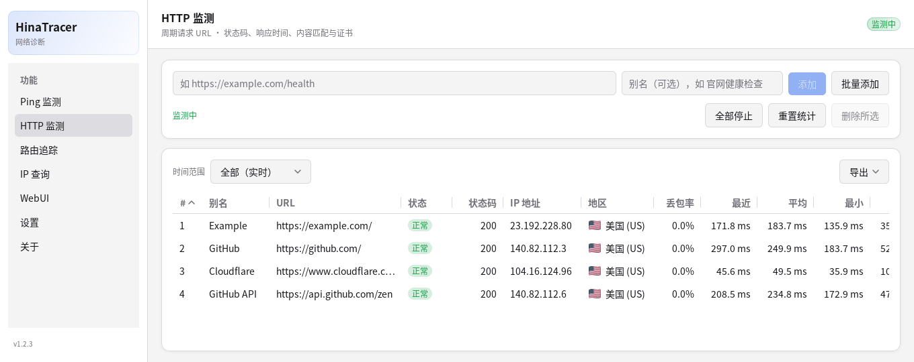
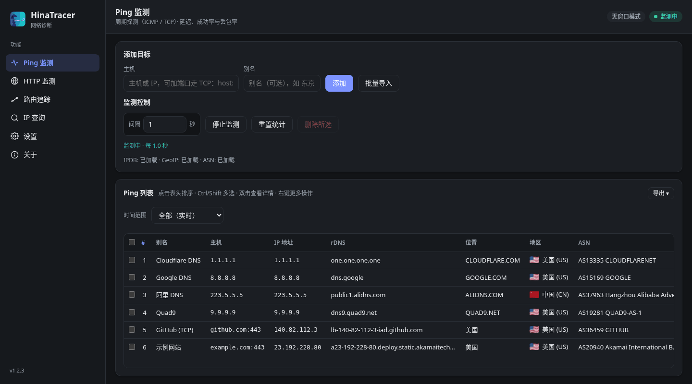

[English](README.md) | 中文(简体) | [中文(繁體)](README.zh-HK.md) | [日本語](README.ja.md)

# HinaTracer


适用于 Windows、macOS 和 Linux 的网络工具：Ping 与 HTTP 监测、路由追踪 / MTR、IP 查询，每个地址都显示位置、地区和 ASN。可以作为桌面程序使用，也可以在浏览器（WebUI）、命令行或 AI 助手（MCP）中使用。

## 截图

<p align="center"><br /><sub>Ping 监测</sub></p>

<table>
  <tr>
    <td width="50%" align="center"><br /><sub>路由追踪（MTR 模式）</sub></td>
    <td width="50%" align="center"><br /><sub>HTTP 监测</sub></td>
  </tr>
</table>

<p align="center"><br /><sub>浏览器中的 WebUI（深色主题）</sub></p>

## 目录

- [功能](#功能)
- [下载与安装](#下载与安装)
- [快速上手](#快速上手)
- [WebUI](#webui)
- [远程数据源](#远程数据源)
- [命令行](#命令行)
- [AI 客户端 MCP](#ai-客户端-mcp)
- [数据文件](#数据文件)
- [设置、文件与语言](#设置文件与语言)
- [常见问题](#常见问题)
- [许可证](#许可证)

## 功能

### Ping 与 HTTP 监测
- 同时监测多个目标：成功/失败次数与比例，最近 / 平均 / 最小 / 最大 / 中位延迟，IP、位置、地区和 ASN。
- ICMP Ping（`example.com`、`1.1.1.1`、`2606:4700:4700::1111`），或带端口的 TCP Ping（`example.com:443`、`[2606:4700:4700::1111]:443`）。
- HTTP 监测网站和 API：请求方法（GET、HEAD、POST、PUT、PATCH、DELETE、OPTIONS 或自定义）、请求体与 Content-Type、间隔、超时、期望状态码（如 `200-299,301` 或 `2xx`；留空为 200–399）、文本或正则匹配（可取反）、自定义请求头、跟随重定向、忽略 TLS 错误。详情窗口显示 DNS / 连接 / TLS / 首字节耗时和证书剩余天数。
- 启用 / 禁用、别名、拖动排序、批量导入、启动时自动开始（默认关闭）。

### 路由追踪 / MTR
- 每个追踪在单独的标签页中运行；MTR 模式持续探测每一跳。可以一键全部开始或停止。
- 在 Ping 目标或 IP 查询结果上右键即可追踪；某一跳可以一键加入 Ping 监测。
- **导出**：在跳数结果上方的「导出」按钮或标签页右键菜单中，把当前标签页或全部标签页（打包为 zip）导出为 TXT（用空格对齐的列，适合等宽字体查看；中文按两格计算，建议使用中文等宽字体如等距更纱黑体、新宋体）、CSV 或 Markdown（标题与简短列表后接管道表格）。文件以别名（或目标）命名。「复制 TXT」把同样的内容复制到剪贴板（全部标签页时依次排列，每个标签页前有一行标题）；「复制 Markdown」同理，合并为一个文档，每个标签页一个 `##` 小节；超过 5 MB 时请改用导出。

### IP 查询
- 查询 IP 或域名，每行一个。域名会解析出全部 IPv4 和 IPv6 地址，并分别测一次延迟。

### 历史与图表
- 双击某一行（或按 Enter）打开详情窗口查看延迟图表：按每次探测、每分钟、小时、天、周或月（平均线、最小–最大区间、丢包柱、十字准线）。
- 可选把 Ping 和 HTTP 的历史与表格统计保存到磁盘（SQLite，默认保留 90 天），重启后统计继续累计。
- 详情窗口的「导出」菜单可导出 CSV、TXT 或 Markdown：`time,target,alias,ip,samples,avg,min,max,loss%`。「复制 TXT」「复制 Markdown」把同样的内容复制到剪贴板。

### 表格
- 任意列排序，调整列宽和列顺序（会记住），Ctrl/⌘ 或 Shift 多选（Ctrl+A / ⌘+A 全选），右键对所有选中行操作。
- **复制列**：把选中行的某一列复制出来，每行一个值。
- **导出表格**：Ping、HTTP 和 IP 查询表格上方的「导出 ▾」按钮按当前显示的样子（列顺序、排序、时间范围统计）把表格导出为 CSV（UTF-8 带 BOM）、TXT（空格对齐）或 Markdown，或复制为 TXT / Markdown。选中了行时可选「全部行」或「仅选中行」。文件名如 `hinatracer-ping-YYYYMMDD-HHMMSS.csv`。访客也可导出；HTTP 导出不含请求头的值和请求体，URL 中的密码和令牌显示为 `***`。
- **时间范围**：Ping、HTTP 和路由追踪表格可以显示某个时间段的统计，而不是实时累计：今天、昨天、本周、上周（每周从周一开始）、本月、上月、今年、去年，或精确到分钟的自定义起止时间。筛选生效时会显示当前范围；点「清除筛选」回到实时。Ping 与 HTTP 需要开启保存历史；路由追踪使用程序本次启动以来的探测。较早的数据只保存为分钟/小时/天汇总，这类时间段的中位数为估算值。

### 桌面提醒
在 **设置 → 桌面提醒** 中，默认全部关闭（仅桌面程序）：
- 目标掉线（连续失败达到设定次数，默认 3 次，可设 1–100）时发送系统通知，可选恢复时也通知。适用于正在运行的 Ping 和 HTTP 监测；短时间内的多条会合并为一条。
- 托盘图标（显示窗口、全部开始/停止 Ping 或 HTTP 监测、退出），可选关闭窗口时最小化到托盘。

### WebUI、远程数据源、命令行与 MCP
- **WebUI**：在浏览器中使用全部功能，可以从桌面程序启动，也可以无窗口运行（`--web`），支持密码、访客模式和 API 令牌。
- **远程数据源**：桌面程序可以显示并控制另一台 HinaTracer，例如 Linux 服务器。
- **命令行** 和 **MCP**，方便脚本和 AI 助手使用。

### 其他
- 检查更新（正式版或预发布版），自动下载、校验并安装新版本。
- 中文(简体)、中文(繁體)、日本語、English，也支持自定义语言包；浅色、深色或跟随系统主题。
- 桌面程序只会运行一个：再次打开 HinaTracer 会把已运行的窗口带到前面。

## 下载与安装

从 **[GitHub Releases](https://github.com/hinasatou/hinatracer/releases)** 下载最新版本。

| 平台 | 文件 | 说明 |
|------|------|------|
| Windows (x64) | `HinaTracer-vX.Y.Z-windows-amd64-setup.exe` | 安装程序（推荐），为当前用户安装，无需管理员权限 |
| Windows (x64) | `HinaTracer-vX.Y.Z-windows-amd64.zip` | 便携版：解压后运行 `HinaTracer.exe` |
| macOS (Apple 芯片 / Intel) | `HinaTracer-vX.Y.Z-macos-arm64.dmg` / `-macos-amd64.dmg` | 安装磁盘映像（推荐） |
| macOS (Apple 芯片 / Intel) | `HinaTracer-vX.Y.Z-macos-arm64.zip` / `-macos-amd64.zip` | 内含 `HinaTracer.app` |
| Linux (x64) | `HinaTracer-vX.Y.Z-linux-amd64.deb` | Debian / Ubuntu 桌面程序 |
| Linux (x64) | `HinaTracer-vX.Y.Z-linux-amd64.tar.gz` | 便携桌面程序，含图标 |
| Linux (x64) | `HinaTracer-vX.Y.Z-linux-amd64` | 单个可执行文件（桌面、`--web` 或命令行） |
| Linux 服务器 | `HinaTracer-vX.Y.Z-linux-amd64-server.deb` | 只运行 WebUI，作为 systemd 服务 |
| 全部 | `SHA256SUMS.txt` | 校验和 |

**macOS 安装。** 打开 `.dmg`，把 **HinaTracer** 拖到 **Applications**（应用程序）文件夹。

**macOS 首次打开。** 程序没有苹果签名，macOS 可能提示无法验证开发者，或建议移到废纸篓。右键 `HinaTracer.app` → **打开**（或 **系统设置 → 隐私与安全性 → 仍要打开**），或者执行一次：

```bash
xattr -dr com.apple.quarantine /Applications/HinaTracer.app
```

**Linux Ping 权限。** 如果 Ping 提示权限错误，允许非特权 ICMP，或给程序加上原始套接字权限：

```bash
sudo sysctl -w net.ipv4.ping_group_range="0 2147483647"   # 重启前有效
sudo setcap cap_net_raw+ep /path/to/hinatracer              # 或者这个，一次即可
```

两种方式下路由追踪 / MTR 都能显示每一跳，普通用户也可以。

**Linux 服务器包（Debian / Ubuntu）。** 只运行 WebUI，由 systemd 管理：

```bash
sudo apt install ./HinaTracer-vX.Y.Z-linux-amd64-server.deb
sudo -u hinatracer hinatracer web passwd --config /etc/hinatracer/config.json
sudo systemctl restart hinatracer
```

它会安装 `/usr/bin/hinatracer`、服务 `hinatracer.service`（用户 `hinatracer`，带 `CAP_NET_RAW`）、配置 `/etc/hinatracer/config.json`，数据放在 `/var/lib/hinatracer`，默认监听 `http://127.0.0.1:8790/`。监听其他地址前必须设置密码。请用包管理器升级（这里内置更新只提示新版本）。

## 快速上手

1. 启动 HinaTracer，在 **设置 → 下载/更新全部** 获取[数据文件](#数据文件)（可选，用于位置、地区和 ASN）。
2. **Ping 监测**：输入主机（`1.1.1.1`、`example.com:443`）并点 **添加**，或用 **批量导入**，每行一个 `主机` 或 `主机,别名`（`#` 开头为注释）。点 **开始监测**。
3. **HTTP 监测**：添加一个 URL，或用 **批量添加**，每行一个 `URL 别名`。右键 → **编辑** 设置方法、状态码、匹配和请求头。
4. **路由追踪**：在标签页中输入主机，点 **开始追踪**；勾选 MTR 模式可持续探测。
5. **IP 查询**：粘贴 IP 或域名，每行一个。
6. 双击任意一行查看详情和图表。

## WebUI

**启动方式**：在桌面程序的 **WebUI** 页面选择绑定 IP 和端口，点 **启动**；勾选 *打开 HinaTracer 时自动启动 Web 服务* 可每次自动运行。也可以无窗口运行：

```
hinatracer --web                                # 使用已保存的地址，默认 127.0.0.1:8790
hinatracer --web --listen 0.0.0.0:8790          # 允许其他设备访问（需要密码）
hinatracer --web --web-host 127.0.0.1 --web-port 9000
```

浏览器和桌面窗口共享同一份设置和正在运行的任务。无窗口模式会把地址打印出来，并写入 `config.json` 旁边的 `web.log`；按 Ctrl+C 停止。WebUI 页面始终显示服务器实际监听的地址。

**密码。** `127.0.0.1` 只能本机访问。其他地址都需要访问密码，可在 WebUI 页面设置，或者：

```
hinatracer web passwd                       # 提示输入密码
hinatracer web passwd --config FILE         # 指定其他配置文件
hinatracer web passwd --clear               # 清除密码
```

也可以用环境变量 `HINATRACER_WEB_PASSWORD`。密码只以加盐哈希保存，不会显示出来。修改密码会让所有浏览器退出登录。WebUI 使用普通 HTTP：在不可信的网络中请保持 `127.0.0.1`，或放在 HTTPS 反向代理后面。

**访客模式。** 设置密码后勾选 **允许访客模式**。访客无需密码即可登录，能查看全部内容但不能修改；看不到文件路径、访问设置和 HTTP 请求头的值。

**API 令牌。** 在 WebUI 页面创建令牌，角色为 **管理员**（完全权限）或 **访客**（只读）。令牌只显示一次；丢失后只能吊销并重新创建。

**语言。** **设置 → 外观 → 我的语言** 只对当前浏览器生效（所有人都能设置，包括访客；选 **跟随默认** 即取消）。管理员还能设置 **默认语言**，它会写入配置。

## 远程数据源

**设置 → 数据源 → 远程 WebUI** 让桌面窗口显示并控制另一台 HinaTracer，而不是本机。

- 输入 WebUI 地址，用管理员密码、API 令牌或访客身份（只读）登录。密码只用来创建一次令牌，不会保存。
- 每个页面的用法都和本地一样。设置页把 **本机** 设置和 **远程** 服务器设置分开显示。
- 退出程序或切换回本地，都不会停止服务器上的任何任务。
- **启动时自动连接远程 WebUI**（连接成功后才显示，默认关闭）。用 **切换回本地** 回到本机。

## 命令行

在桌面程序的 WebUI 或 `hinatracer --web` 运行时，可以从终端控制它。运行 `hinatracer help` 查看全部选项。

| 命令 | 用途 |
|------|------|
| `ping list` / `ping add <host> [--alias A]` / `ping import <file>` | Ping 目标 |
| `ping enable` / `disable` / `delete` / `alias` / `move` `<id\|host>` | 编辑目标 |
| `ping start` / `ping stop` / `ping reset [--yes]` / `ping interval <s>` | 运行与重置 |
| `ping history <id\|host> [--range R] [--csv\|--txt\|--md]` | 历史（R：probe、minute、hour、day、week、month） |
| `http list` / `http add <url> [options]` / `http edit` / `http import` | HTTP 目标 |
| `http start` / `http stop` / `http reset [--yes]` / `http history` | 运行、重置、历史 |
| `trace list` / `trace new [host] [--mtr true] [--start]` / `trace show <tab>` | 路由追踪标签页 |
| `trace start\|stop\|close <tab>` / `trace startall` / `trace stopall` | 控制标签页 |
| `trace export <tab>\|--all [--format txt\|csv\|md] [--out FILE]` | 导出路由追踪结果（全部标签页为 zip） |
| `ping list` / `http list` / `lookup results` `--format csv\|txt\|md [--out FILE] [--sort COL [--desc]] [--cols a,b]` | 导出 Ping / HTTP / IP 查询表格 |
| `ping list` / `http list` / `trace show <tab>` 加 `--range today`（`yesterday`、`thisweek`、`lastweek`、`thismonth`、`lastmonth`、`thisyear`、`lastyear`）或 `--from T --to T` | 某个时间段的统计（T：`2026-10-01 08:00` 或 RFC 3339） |
| `lookup <ip\|domain>...` | IP 查询 |
| `settings get` / `settings set key=value...` | 设置 |
| `data download` / `update check` | 数据文件与更新 |
| `web status` / `web listen` / `web guest on\|off` / `web passwd` | WebUI 访问 |
| `token list` / `token create <name> [--role admin\|guest]` / `token revoke <id>` | API 令牌 |
| `info` / `mcp tools` / `api <METHOD> <PATH> [JSON]` | 其他 |

通用选项：`--server URL`（或 `HINATRACER_SERVER`，默认为已保存的 WebUI 地址）、`--token TOKEN`（或 `HINATRACER_TOKEN`，本机且未设密码时不需要）和 `--json`。

程序选项：`--web`、`--listen ADDR`、`--web-host`、`--web-port`、`--config FILE`（或 `HINATRACER_CONFIG`）、`--server-mode`、`--version`、`--help`。

## AI 客户端 MCP

WebUI 运行时，HinaTracer 同时是一个 MCP 服务器（Streamable HTTP），地址为 `http://HOST:PORT/mcp`。在 AI 客户端中添加它并带上 API 令牌：

```json
{
  "mcpServers": {
    "hinatracer": {
      "type": "http",
      "url": "http://127.0.0.1:8790/mcp",
      "headers": { "Authorization": "Bearer htk_your_token_here" }
    }
  }
}
```

访客令牌只能读取；管理员令牌还能管理目标、路由追踪和设置。未设置访问密码时，本机客户端不需要令牌。`hinatracer mcp tools` 可列出所有工具。

## 数据文件

位置、地区和 ASN 来自三个免费文件。**设置 → 下载/更新全部** 可一次获取，也可以指定已有的文件。没有这些文件时，相关列显示“—”。

| 文件 | 用途 | 来源 |
|------|------|------|
| `qqwry.ipdb` | 位置 | [nmgliangwei/qqwry.ipdb](https://github.com/nmgliangwei/qqwry.ipdb) |
| `Country.mmdb` | 地区与旗帜 | [Loyalsoldier/geoip](https://github.com/Loyalsoldier/geoip) |
| `ip2asn-combined.tsv.gz` | ASN、网络名称、ASN 地区 | [iptoasn.com](https://iptoasn.com/) |

这些文件遵循各自的许可证。

## 设置、文件与语言

设置、目标和标签页保存在 `config.json` 中；`history.db`（开启时）和 `crash.log`（崩溃后）在同一文件夹。

| 系统 | 文件夹 |
|------|--------|
| Windows | `%APPDATA%\hinatracer\` |
| macOS | `~/Library/Application Support/hinatracer/` |
| Linux | `~/.config/hinatracer/` |
| 服务器包 | `/etc/hinatracer/config.json`，数据在 `/var/lib/hinatracer` |

**自定义语言包。** 把 `*.json` 文件放进上面文件夹（或程序旁边）的 `lang` 文件夹。`code` 与内置语言相同的包会覆盖其文字；缺少的文字会回退到英文。可以参考 [`i18n/`](i18n/) 中的内置语言包：

```json
{ "name": "English", "code": "en", "strings": { "nav.ping": "Ping Monitor" } }
```

## 常见问题

**位置 / 地区 / ASN 显示“—”。** 下载数据文件（设置 → 下载/更新全部）。

**Linux：Ping 失败或路由追踪全是超时。** 按[下载与安装](#下载与安装)中的方法设置 `ping_group_range` 或 `setcap`。

**macOS 提示程序已损坏或来自身份不明的开发者。** 见上面的 *macOS 首次打开*。

**WebUI 无法在 0.0.0.0 上启动。** 先设置访问密码。

**忘记了 WebUI 密码。** 在那台电脑上运行 `hinatracer web passwd`（其他配置文件加 `--config`）。

**第二次打开 HinaTracer 没反应。** 程序已经在运行（可能在托盘里）；已有的窗口会被带到前面。

**重置统计时要求确认。** 开启保存历史时，重置会永久删除已保存的统计。命令行中加 `--yes`。

**时间范围列表是灰色的。** Ping 与 HTTP 的筛选读取已保存的历史：请开启「设置 → 监测历史 → 保存监测历史到磁盘」。

## 许可证

[MIT 许可证](LICENSE)。第三方数据文件遵循各自的许可证。
