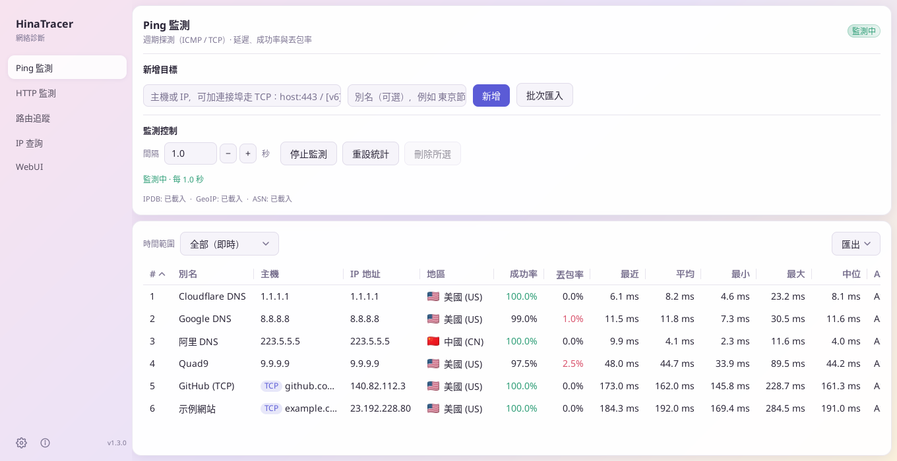
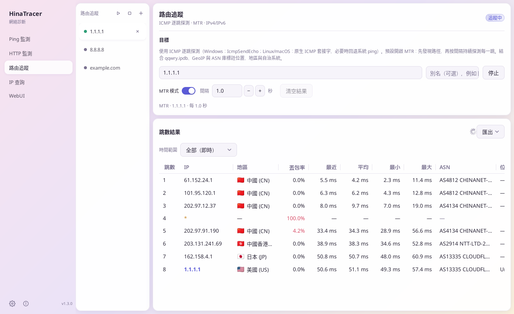
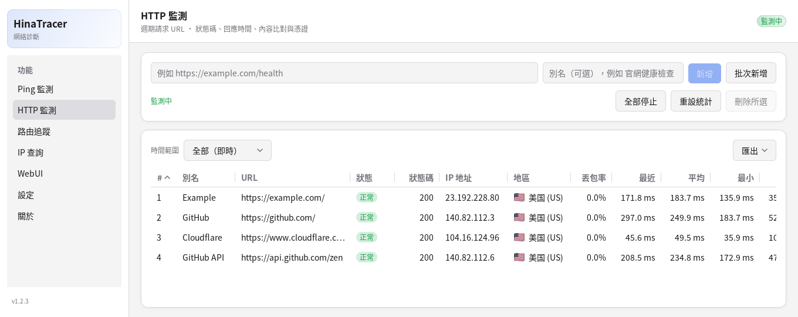
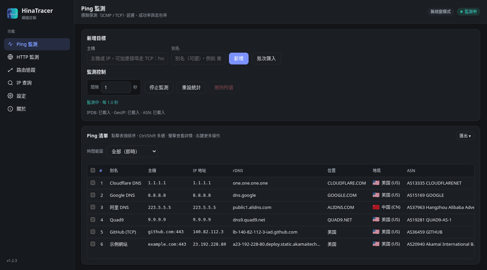

[English](README.md) | [中文(简体)](README.zh-CN.md) | 中文(繁體) | [日本語](README.ja.md)

# HinaTracer


適用於 Windows、macOS 和 Linux 的網絡工具：Ping 與 HTTP 監測、路由追蹤 / MTR、IP 查詢，每個位址都顯示位置、地區和 ASN。可以作為桌面程式使用，也可以在瀏覽器（WebUI）、命令列或 AI 助理（MCP）中使用。

## 截圖

<p align="center"><br /><sub>Ping 監測</sub></p>

<table>
  <tr>
    <td width="50%" align="center"><br /><sub>路由追蹤（MTR 模式）</sub></td>
    <td width="50%" align="center"><br /><sub>HTTP 監測</sub></td>
  </tr>
</table>

<p align="center"><br /><sub>瀏覽器中的 WebUI（深色主題）</sub></p>

## 目錄

- [功能](#功能)
- [下載與安裝](#下載與安裝)
- [快速上手](#快速上手)
- [WebUI](#webui)
- [遠端資料來源](#遠端資料來源)
- [命令列](#命令列)
- [AI 用戶端 MCP](#ai-用戶端-mcp)
- [資料檔案](#資料檔案)
- [設定、檔案與語言](#設定檔案與語言)
- [常見問題](#常見問題)
- [授權條款](#授權條款)

## 功能

### Ping 與 HTTP 監測
- 同時監測多個目標：成功/失敗次數與比例，最近 / 平均 / 最小 / 最大 / 中位延遲，IP、位置、地區和 ASN。
- ICMP Ping（`example.com`、`1.1.1.1`、`2606:4700:4700::1111`），或帶連接埠的 TCP Ping（`example.com:443`、`[2606:4700:4700::1111]:443`）。
- HTTP 監測網站和 API：請求方法（GET、HEAD、POST、PUT、PATCH、DELETE、OPTIONS 或自訂）、請求內容與 Content-Type、間隔、逾時、預期狀態碼（如 `200-299,301` 或 `2xx`；留空為 200–399）、文字或正規表示式比對（可反轉）、自訂請求標頭、跟隨重新導向、忽略 TLS 錯誤。詳情視窗顯示 DNS / 連線 / TLS / 首位元組耗時和憑證剩餘天數。
- 啟用 / 停用、別名、拖曳排序、批次匯入、啟動時自動開始（預設關閉）。

### 路由追蹤 / MTR
- 每個追蹤在獨立的分頁中執行；MTR 模式持續探測每一跳。可以一鍵全部開始或停止。
- 在 Ping 目標或 IP 查詢結果上按右鍵即可追蹤；某一跳可以一鍵加入 Ping 監測。
- **匯出**：在跳數結果上方的「匯出」按鈕或分頁右鍵選單中，把目前分頁或全部分頁（打包為 zip）匯出為 TXT（以空格對齊的欄，適合等寬字型檢視；中文按兩格計算，建議使用中文等寬字型如等距更紗黑體、細明體）、CSV 或 Markdown（標題與簡短清單後接管線表格）。檔案以別名（或目標）命名。「複製 TXT」把同樣的內容複製到剪貼簿（全部分頁時依次排列，每個分頁前有一行標題）；「複製 Markdown」同理，合併為一份文件，每個分頁一個 `##` 小節；超過 5 MB 時請改用匯出。

### IP 查詢
- 查詢 IP 或網域，每行一個。網域會解析出全部 IPv4 和 IPv6 位址，並分別測一次延遲。

### 歷史與圖表
- 按兩下某一行（或按 Enter）開啟詳情視窗查看延遲圖表：按每次探測、每分鐘、小時、日、週或月（平均線、最小–最大區間、丟包柱、十字準線）。
- 可選擇把 Ping 和 HTTP 的歷史與表格統計儲存到磁碟（SQLite，預設保留 90 日），重新啟動後統計繼續累計。
- 詳情視窗的「匯出」選單可匯出 CSV、TXT 或 Markdown：`time,target,alias,ip,samples,avg,min,max,loss%`。「複製 TXT」「複製 Markdown」把同樣的內容複製到剪貼簿。

### 表格
- 任意欄排序，調整欄寬和欄順序（會記住），Ctrl/⌘ 或 Shift 多選（Ctrl+A / ⌘+A 全選），按右鍵對所有選取的行操作。
- **複製欄**：把選取行的某一欄複製出來，每行一個值。
- **匯出表格**：Ping、HTTP 和 IP 查詢表格上方的「匯出 ▾」按鈕按目前顯示的樣子（欄順序、排序、時間範圍統計）把表格匯出為 CSV（UTF-8 帶 BOM）、TXT（空格對齊）或 Markdown，或複製為 TXT / Markdown。選取了行時可選「全部列」或「只限已選列」。檔案名稱如 `hinatracer-ping-YYYYMMDD-HHMMSS.csv`。訪客也可匯出；HTTP 匯出不含請求標頭的值和請求內容，URL 中的密碼和權杖顯示為 `***`。
- **時間範圍**：Ping、HTTP 和路由追蹤表格可以顯示某個時段的統計，而不是即時累計：今天、昨天、本週、上週（每週從週一開始）、本月、上月、今年、去年，或精確到分鐘的自訂起訖時間。篩選生效時會顯示目前範圍；按「清除篩選」回到即時。Ping 與 HTTP 需要開啟儲存歷史；路由追蹤使用程式本次啟動以來的探測。較早的數據只儲存為分鐘/小時/天彙總，這類時段的中位數為估算值。

### 桌面提醒
在 **設定 → 桌面提醒** 中，預設全部關閉（僅桌面程式）：
- 目標斷線（連續失敗達到設定次數，預設 3 次，可設 1–100）時發送系統通知，可選擇恢復時也通知。適用於正在執行的 Ping 和 HTTP 監測；短時間內的多條會合併為一條。
- 系統匣圖示（顯示視窗、全部開始/停止 Ping 或 HTTP 監測、結束），可選擇關閉視窗時最小化到系統匣。

### WebUI、遠端資料來源、命令列與 MCP
- **WebUI**：在瀏覽器中使用全部功能，可以從桌面程式啟動，也可以無視窗執行（`--web`），支援密碼、訪客模式和 API 權杖。
- **遠端資料來源**：桌面程式可以顯示並控制另一部 HinaTracer，例如 Linux 伺服器。
- **命令列** 和 **MCP**，方便指令碼和 AI 助理使用。

### 外觀
- **玻璃樣式**：漸變背景上的浮動面板；在支援的 Windows 11 上使用亞克力背景，其他系統使用實色漸變。Windows 上標題列由 HinaTracer 繪製，支援 Windows 11 貼齊版面配置。**設定** 和 **關於** 是側邊欄左下角的圖示。
- **設定 → 外觀 → 配色**：6 套配色（櫻花、薄荷、海洋、晚霞、石墨、抹茶），每套都有淺色和深色。立即生效並會記住。

### 其他
- 檢查更新（正式版或預覽版），自動下載、驗證並安裝新版本。
- 中文(简体)、中文(繁體)、日本語、English，也支援自訂語言套件；淺色、深色或跟隨系統主題。
- 桌面程式只會執行一個：再次開啟 HinaTracer 會把已執行的視窗帶到前面。

## 下載與安裝

從 **[GitHub Releases](https://github.com/hinasatou/hinatracer/releases)** 下載最新版本。

| 平台 | 檔案 | 說明 |
|------|------|------|
| Windows (x64) | `HinaTracer-vX.Y.Z-windows-amd64-setup.exe` | 安裝程式（建議），為目前使用者安裝，無需管理員權限 |
| Windows (x64) | `HinaTracer-vX.Y.Z-windows-amd64.zip` | 可攜版：解壓後執行 `HinaTracer.exe` |
| macOS (Apple 晶片 / Intel) | `HinaTracer-vX.Y.Z-macos-arm64.dmg` / `-macos-amd64.dmg` | 安裝磁碟映像（建議） |
| macOS (Apple 晶片 / Intel) | `HinaTracer-vX.Y.Z-macos-arm64.zip` / `-macos-amd64.zip` | 內含 `HinaTracer.app` |
| Linux (x64) | `HinaTracer-vX.Y.Z-linux-amd64.deb` | Debian / Ubuntu 桌面程式 |
| Linux (x64) | `HinaTracer-vX.Y.Z-linux-amd64.tar.gz` | 可攜桌面程式，含圖示 |
| Linux (x64) | `HinaTracer-vX.Y.Z-linux-amd64` | 單一執行檔（桌面、`--web` 或命令列） |
| Linux 伺服器 | `HinaTracer-vX.Y.Z-linux-amd64-server.deb` | 只執行 WebUI，作為 systemd 服務 |
| 全部 | `SHA256SUMS.txt` | 校驗碼 |

**macOS 安裝。** 開啟 `.dmg`，把 **HinaTracer** 拖到 **Applications**（應用程式）資料夾。

**macOS 首次開啟。** 程式沒有 Apple 簽署，macOS 可能提示無法驗證開發者，或建議移到垃圾桶。按右鍵 `HinaTracer.app` → **打開**（或 **系統設定 → 私隱與安全性 → 仍要打開**），或者執行一次：

```bash
xattr -dr com.apple.quarantine /Applications/HinaTracer.app
```

**Linux Ping 權限。** 如果 Ping 提示權限錯誤，允許非特權 ICMP，或給程式加上原始通訊端權限：

```bash
sudo sysctl -w net.ipv4.ping_group_range="0 2147483647"   # 重新開機前有效
sudo setcap cap_net_raw+ep /path/to/hinatracer              # 或者這個，一次即可
```

兩種方式下路由追蹤 / MTR 都能顯示每一跳，一般使用者也可以。

**Linux 伺服器套件（Debian / Ubuntu）。** 只執行 WebUI，由 systemd 管理：

```bash
sudo apt install ./HinaTracer-vX.Y.Z-linux-amd64-server.deb
sudo -u hinatracer hinatracer web passwd --config /etc/hinatracer/config.json
sudo systemctl restart hinatracer
```

它會安裝 `/usr/bin/hinatracer`、服務 `hinatracer.service`（使用者 `hinatracer`，帶 `CAP_NET_RAW`）、設定檔 `/etc/hinatracer/config.json`，資料放在 `/var/lib/hinatracer`，預設監聽 `http://127.0.0.1:8790/`。監聽其他位址前必須設定密碼。請用套件管理員升級（這裡內建更新只提示新版本）。

## 快速上手

1. 啟動 HinaTracer，在 **設定 → 下載/更新全部** 取得[資料檔案](#資料檔案)（可選，用於位置、地區和 ASN）。
2. **Ping 監測**：輸入主機（`1.1.1.1`、`example.com:443`）並按 **新增**，或用 **批次匯入**，每行一個 `主機` 或 `主機,別名`（`#` 開頭為註解）。按 **開始監測**。
3. **HTTP 監測**：新增一個 URL，或用 **批次新增**，每行一個 `URL 別名`。按右鍵 → **編輯** 設定方法、狀態碼、比對和請求標頭。
4. **路由追蹤**：在分頁中輸入主機，按 **開始追蹤**；勾選 MTR 模式可持續探測。
5. **IP 查詢**：貼上 IP 或網域，每行一個。
6. 按兩下任意一行查看詳情和圖表。

## WebUI

**啟動方式**：在桌面程式的 **WebUI** 頁面選擇綁定 IP 和連接埠，按 **啟動**；勾選 *開啟 HinaTracer 時自動啟動 Web 服務* 可每次自動執行。也可以無視窗執行：

```
hinatracer --web                                # 使用已儲存的位址，預設 127.0.0.1:8790
hinatracer --web --listen 0.0.0.0:8790          # 允許其他裝置存取（需要密碼）
hinatracer --web --web-host 127.0.0.1 --web-port 9000
```

瀏覽器和桌面視窗共用同一份設定和正在執行的工作。無視窗模式會把位址列印出來，並寫入 `config.json` 旁邊的 `web.log`；按 Ctrl+C 停止。WebUI 頁面始終顯示伺服器實際監聽的位址。

**密碼。** `127.0.0.1` 只能本機存取。其他位址都需要存取密碼，可在 WebUI 頁面設定，或者：

```
hinatracer web passwd                       # 提示輸入密碼
hinatracer web passwd --config FILE         # 指定其他設定檔
hinatracer web passwd --clear               # 清除密碼
```

也可以用環境變數 `HINATRACER_WEB_PASSWORD`。密碼只以加鹽雜湊儲存，不會顯示出來。修改密碼會令所有瀏覽器登出。WebUI 使用一般 HTTP：在不可信的網絡中請保持 `127.0.0.1`，或放在 HTTPS 反向代理後面。

**訪客模式。** 設定密碼後勾選 **允許訪客模式**。訪客無需密碼即可登入，能查看全部內容但不能修改；看不到檔案路徑、存取設定和 HTTP 請求標頭的值。

**API 權杖。** 在 WebUI 頁面建立權杖，角色為 **管理員**（完整權限）或 **訪客**（唯讀）。權杖只顯示一次；遺失後只能撤銷並重新建立。

**語言。** **設定 → 外觀 → 我的語言** 只對目前瀏覽器生效（所有人都能設定，包括訪客；選 **跟隨預設** 即取消）。管理員還能設定 **預設語言**，它會寫入設定檔。

**配色。** WebUI 也有同樣的玻璃外觀和配色。管理員設定 **預設配色**（寫入設定檔，桌面版也使用它）。每個瀏覽器（包括訪客）都可以在 **設定 → 外觀 → 我的配色** 和 **我的外觀**（淺色/深色）中跟隨預設或自行選擇，只儲存在這個瀏覽器中。

## 遠端資料來源

**設定 → 資料來源 → 遠端 WebUI** 讓桌面視窗顯示並控制另一部 HinaTracer，而不是本機。

- 輸入 WebUI 位址，用管理員密碼、API 權杖或訪客身分（唯讀）登入。密碼只用來建立一次權杖，不會儲存。
- 每個頁面的用法都和本機一樣。設定頁把 **本機** 設定和 **遠端** 伺服器設定分開顯示。
- 結束程式或切換回本機，都不會停止伺服器上的任何工作。
- **啟動時自動連接遠端 WebUI**（連線成功後才顯示，預設關閉）。用 **切換回本機** 回到本機。

## 命令列

在桌面程式的 WebUI 或 `hinatracer --web` 執行時，可以從終端機控制它。執行 `hinatracer help` 查看全部選項。

| 指令 | 用途 |
|------|------|
| `ping list` / `ping add <host> [--alias A]` / `ping import <file>` | Ping 目標 |
| `ping enable` / `disable` / `delete` / `alias` / `move` `<id\|host>` | 編輯目標 |
| `ping start` / `ping stop` / `ping reset [--yes]` / `ping interval <s>` | 執行與重設 |
| `ping history <id\|host> [--range R] [--csv\|--txt\|--md]` | 歷史（R：probe、minute、hour、day、week、month） |
| `http list` / `http add <url> [options]` / `http edit` / `http import` | HTTP 目標 |
| `http start` / `http stop` / `http reset [--yes]` / `http history` | 執行、重設、歷史 |
| `trace list` / `trace new [host] [--mtr true] [--start]` / `trace show <tab>` | 路由追蹤分頁 |
| `trace start\|stop\|close <tab>` / `trace startall` / `trace stopall` | 控制分頁 |
| `trace export <tab>\|--all [--format txt\|csv\|md] [--out FILE]` | 匯出路由追蹤結果（全部分頁為 zip） |
| `ping list` / `http list` / `lookup results` `--format csv\|txt\|md [--out FILE] [--sort COL [--desc]] [--cols a,b]` | 匯出 Ping / HTTP / IP 查詢表格 |
| `ping list` / `http list` / `trace show <tab>` 加 `--range today`（`yesterday`、`thisweek`、`lastweek`、`thismonth`、`lastmonth`、`thisyear`、`lastyear`）或 `--from T --to T` | 某個時段的統計（T：`2026-10-01 08:00` 或 RFC 3339） |
| `lookup <ip\|domain>...` | IP 查詢 |
| `settings get` / `settings set key=value...` | 設定 |
| `data download` / `update check` | 資料檔案與更新 |
| `web status` / `web listen` / `web guest on\|off` / `web passwd` | WebUI 存取 |
| `token list` / `token create <name> [--role admin\|guest]` / `token revoke <id>` | API 權杖 |
| `info` / `mcp tools` / `api <METHOD> <PATH> [JSON]` | 其他 |

通用選項：`--server URL`（或 `HINATRACER_SERVER`，預設為已儲存的 WebUI 位址）、`--token TOKEN`（或 `HINATRACER_TOKEN`，本機且未設密碼時不需要）和 `--json`。

程式選項：`--web`、`--listen ADDR`、`--web-host`、`--web-port`、`--config FILE`（或 `HINATRACER_CONFIG`）、`--server-mode`、`--version`、`--help`。

## AI 用戶端 MCP

WebUI 執行時，HinaTracer 同時是一個 MCP 伺服器（Streamable HTTP），位址為 `http://HOST:PORT/mcp`。在 AI 用戶端中加入它並附上 API 權杖：

```json
{
  "mcpServers": {
    "hinatracer": {
      "type": "http",
      "url": "http://127.0.0.1:8790/mcp",
      "headers": { "Authorization": "Bearer htk_your_token_here" }
    }
  }
}
```

訪客權杖只能讀取；管理員權杖還能管理目標、路由追蹤和設定。未設定存取密碼時，本機用戶端不需要權杖。`hinatracer mcp tools` 可列出所有工具。

## 資料檔案

位置、地區和 ASN 來自三個免費檔案。**設定 → 下載/更新全部** 可一次取得，也可以指定已有的檔案。沒有這些檔案時，相關欄位顯示「—」。

| 檔案 | 用途 | 來源 |
|------|------|------|
| `qqwry.ipdb` | 位置 | [nmgliangwei/qqwry.ipdb](https://github.com/nmgliangwei/qqwry.ipdb) |
| `Country.mmdb` | 地區與旗幟 | [Loyalsoldier/geoip](https://github.com/Loyalsoldier/geoip) |
| `ip2asn-combined.tsv.gz` | ASN、網絡名稱、ASN 地區 | [iptoasn.com](https://iptoasn.com/) |

`qqwry.ipdb` 的位置文字是中文。介面語言不是中文時，會透過 Google 翻譯免費服務翻譯（**設定 > 位置翻譯**，預設開啟，可在那裏關閉）。只傳送地名文字，不會傳送 IP。會使用系統代理（Windows 為 Internet 選項中的代理；不支援 PAC 指令碼，可改設 `HTTPS_PROXY`）。地區名稱跟隨介面語言顯示。

這些檔案遵循各自的授權條款。

## 設定、檔案與語言

設定、目標和分頁儲存在 `config.json` 中；`history.db`（開啟時）和 `crash.log`（當機後）在同一資料夾。

| 系統 | 資料夾 |
|------|--------|
| Windows | `%APPDATA%\hinatracer\` |
| macOS | `~/Library/Application Support/hinatracer/` |
| Linux | `~/.config/hinatracer/` |
| 伺服器套件 | `/etc/hinatracer/config.json`，資料在 `/var/lib/hinatracer` |

**自訂語言套件。** 把 `*.json` 檔案放進上面資料夾（或程式旁邊）的 `lang` 資料夾。`code` 與內建語言相同的套件會覆蓋其文字；缺少的文字會回退到英文。可以參考 [`i18n/`](i18n/) 中的內建語言套件：

```json
{ "name": "English", "code": "en", "strings": { "nav.ping": "Ping Monitor" } }
```

## 常見問題

**位置 / 地區 / ASN 顯示「—」。** 下載資料檔案（設定 → 下載/更新全部）。

**Linux：Ping 失敗或路由追蹤全是逾時。** 按[下載與安裝](#下載與安裝)中的方法設定 `ping_group_range` 或 `setcap`。

**macOS 提示程式已損毀或來自不明的開發者。** 見上面的 *macOS 首次開啟*。

**WebUI 無法在 0.0.0.0 上啟動。** 先設定存取密碼。

**忘記了 WebUI 密碼。** 在那部電腦上執行 `hinatracer web passwd`（其他設定檔加 `--config`）。

**第二次開啟 HinaTracer 沒反應。** 程式已經在執行（可能在系統匣裡）；已有的視窗會被帶到前面。

**重設統計時要求確認。** 開啟儲存歷史時，重設會永久刪除已儲存的統計。命令列中加 `--yes`。

**時間範圍清單是灰色的。** Ping 與 HTTP 的篩選讀取已儲存的歷史：請開啟「設定 → 監測歷史 → 儲存監測歷史到磁碟」。

## 授權條款

[MIT 授權條款](LICENSE)。第三方資料檔案遵循各自的授權條款。
